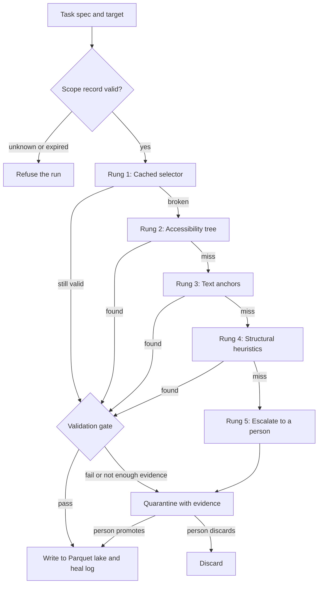

# Selector Drift

Self-healing data extraction for business portals with no API.

When a portal's UI changes, Selector Drift re-finds each field and then has to prove the new match is right before any data is written. If it can't, the run is held for a person to review. A selector that breaks throws an error, but one that heals onto the wrong column returns plausible, wrong numbers for weeks, so the validation gate is the centre of the design.

[](https://github.com/Berakhah/selector-drift/actions/workflows/tests.yml) [](https://github.com/Berakhah/selector-drift/releases) [](LICENSE)

## Quickstart

Needs Python 3.12+ and [uv](https://docs.astral.sh/uv/).

```bash
git clone https://github.com/Berakhah/selector-drift && cd selector-drift
uv sync
uv run pytest -m unit -q        # about 2,300 tests: no browser, no database, no network
uv run uvicorn testbench.portal.app:create_app --factory --port 8080   # the mutating test bench
```

The integration suite needs Postgres and Chromium; `.github/workflows/tests.yml` shows the exact setup CI uses.

**Status: in development.** The pipeline, validation gate, evidence store and test bench exist. The web UI and HTTP API don't, and there are no results from a live portal yet ([details](#status-and-known-limitations)).

## How this was built

I designed it, wrote the specifications with Claude Code, set the evaluation criteria, directed the implementation, and reviewed and tested the changes. Claude Code generated a substantial part of the code under my direction. Counted on 7 Nov 2026: 152 of 157 commits were made through my second account, [@Berakhah-sys](https://github.com/Berakhah-sys), and 155 carry a `Co-Authored-By: Claude` trailer. The suite has 1,434 test functions by static count. The first commit originally carried a wrong date; its spec files were named 2024-11-07, but the commit is co-authored by Claude Opus 5, which didn't exist then. On 4 Nov 2026 I re-dated it to one hour before the second commit (29 Aug 2026); the follow-up commit says so.

## How a run works



Rung 5 is reserved for visual grounding with a model, but v1 makes no model calls, so it hands the field to a person.

The gate's checks live in [`selector_drift/validate/assertions/`](selector_drift/validate/assertions/):

| Check | What it catches |
| --- | --- |
| `FormatAssertion` | Values of the wrong type or format |
| `DomainAssertion` | Values outside an allowed range or set |
| `CrossFieldAssertion` | Fields that no longer agree with each other |
| `DistributionalAssertion` | A shift from recent runs, such as locking onto the adjacent column, where each value looks valid on its own |
| `RowKeyContinuity` | Values that no longer match the last accepted run, joined on the natural key |
| `IndependentRungAgreement` | A heal where a rung from a different signal family lands on a different node |
| `FirstHealConfirmation` | A selector seen for the first time, which needs a person to confirm it |

## Measured results

These come from the project's own [test bench](testbench/README.md), a deliberately mutating claims portal. They are not production results. [`docs/methodology.md`](docs/methodology.md) has the method, the known limits and how to reproduce them.

| Measure (2026-10-16) | Result | What it means |
| --- | --- | --- |
| Benign acceptance | 8/8 mutation classes | On one pinned day, with history; the result varies by day |
| Adversarial refusal | 3/7 classes | The other 4 were written, from the correct nodes |
| Wrong-node writes | 0/7 classes | Checked against the answer key |
| Offline floor | 8/8 benign classes | Rungs 1-4 only, with all network access and model providers blocked |

An earlier 60-day campaign measured which rung resolved each field: rung 1 16.9%, rung 2 69.7%, rung 3 0%, rung 4 13.1%, rung 5 0%. It ran before a bench defect was found and hasn't been re-run on the fixed bench, so its 9 false refusals say nothing about the gate. See the erratum in the methodology.

## Safety rules

- **Scope:** no target runs without a current scope record stating who authorised it.
- **Access:** no bypassing authentication or anti-bot measures. A target that needs evasion is out of scope.
- **Credentials:** the default is a session the client exports after logging in. Stored passwords are a last resort, and TOTP seeds are never stored ([`docs/security.md`](docs/security.md)).
- **Redaction:** screenshots and DOM snapshots are redacted before storage.

## Status and known limitations

**Not built**

- There is no web UI or HTTP API. The API work is in open [PR #1](https://github.com/Berakhah/selector-drift/pull/1).
- The ninety-day live heal log hasn't been run, so there are no results from a live portal.

**Install and CI**

- `bok-core` isn't on PyPI. It is vendored as a pre-built wheel in [`vendor/`](vendor/README.md), with its source commit, build command and sha256, so `uv sync` works on a fresh clone.
- CI runs static checks, the unit suite and the integration suite (Postgres and a real Chromium) on every push and PR. The 63 end-to-end tests (`-m e2e`) don't run in CI yet.
- One unit test is deselected in CI: the guard that refuses a scope record still carrying template placeholders. The scope records are templates until the ninety-day-log targets are chosen, so it can't pass yet; it still fails a local run on purpose.

**Hardening still in draft PRs**

- [#7](https://github.com/Berakhah/selector-drift/pull/7) blocks browser writes after login. Until it merges, "no write-back" holds only because the product has no write path.
- [#6](https://github.com/Berakhah/selector-drift/pull/6) gives the worker a least-privilege Postgres role. Today it connects as the Compose superuser.
- [#5](https://github.com/Berakhah/selector-drift/pull/5) holds a run that lost most of its rows.

**Gate limits**

- With no history, a value attack on the correct nodes can only be caught by the person confirming run one.
- A portal that flips between two layouts asks for confirmation on every flip, because the cache holds one selector per field.
- Rung 3 resolved nothing on the bench, because rung 2 looks for the same label text and runs first.

## Layout

```text
selector_drift/
  scope/        scope records and the authorisation gate
  spec/         task spec schema
  browser/      containerised Playwright driver
  credentials/  credential postures and envelope encryption
  resolve/      the cascade and selector cache
  validate/     the gate, its checks and quarantine
  extract/      typed extraction
  quality/      schema drift, null rates, row counts
  land/         Parquet writer and DuckDB catalog
  orchestrate/  the Prefect pipeline and rung statistics
  heallog/      evidence store, redaction, replay
testbench/      mutating portal, mutation engine, answer-key scorer
tests/          1,434 Python test functions (counted 2026-11-05)
```

Built with Python 3.12, Playwright, Pydantic, PostgreSQL, Alembic, Prefect, Parquet, DuckDB and Docker Compose.

## Security

Report a vulnerability privately through GitHub; see [SECURITY.md](SECURITY.md).

## License

Apache-2.0. See [`LICENSE`](LICENSE).
